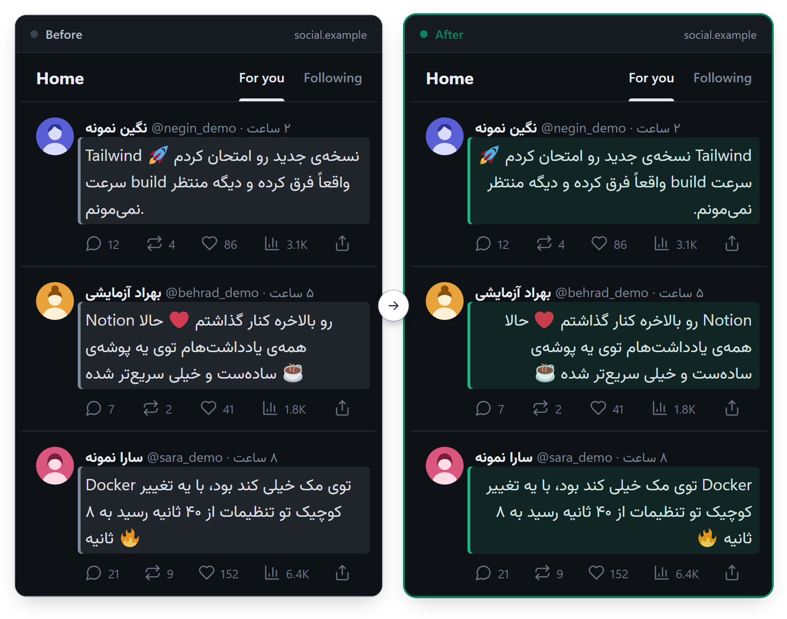
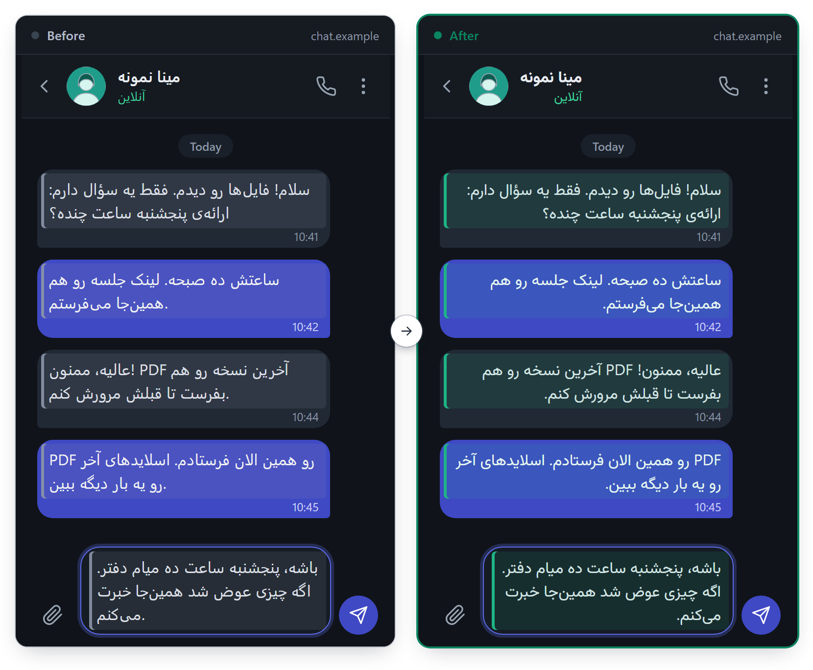
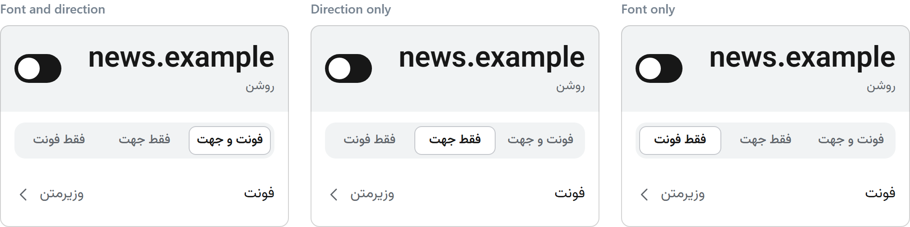

<h1 align="center">Persian Typography</h1>

<p align="center">
A Manifest V3 extension for Chromium. It gives Persian text on web pages the Vazirmatn font and a right-to-left direction, one text block at a time.
</p>

<p align="center">
  
  <br>
  <em>Persian posts that start with a Latin word and contain emoji, before and after.</em>
</p>

## What you get

- **Vazirmatn for Persian letters only.** Latin letters, digits, icons and emoji keep the page's own fonts.
- **A direction for each text block.** A block with Persian text reads right to left, including a post that begins with an English name. Page layout, centred headings and code keep their order.
- **It keeps up with the page.** It handles new and streaming text, lists, data tables, editable boxes, nested open shadow roots and frames. The font also loads on pages with a strict Content Security Policy.
- **One control for each site.** The popup has a switch and a font choice. See [One control per site](#one-control-per-site).
- **Nothing leaves your computer.** The extension never rewrites page text and never contacts a server.

## See it

This chat keeps its text in open shadow roots. The picture shows its messages and the message box while typing, before and after. Each message follows its own text, and the box turns right to left once it holds Persian.

<p align="center">
  
  <br>
  <em>A chat inside open shadow roots, before and after.</em>
</p>

## One control per site

Click the toolbar icon to open the popup. Its switch turns the whole site off (the icon turns grey) or on with both parts. While the site is on, one row under the switch chooses what the extension does there:

| Part | What it does on that site |
| --- | --- |
| **فونت و جهت** | Vazirmatn and the right-to-left direction. This is the default. |
| **فقط جهت** | The direction only. The site keeps its own font. |
| **فقط فونت** | The font only. The site keeps its own direction. |

<p align="center">
  
  <br>
  <em>The popup: the site switch and, under it, the row with three parts.</em>
</p>

Use «فقط جهت» on a site that already has a good Persian font. For example, khabaronline.ir can keep its own font while the extension fixes the direction. The icon stays coloured when either part is on. Open tabs and embedded frames follow a change at once, without a reload. Switching a part off takes back everything that part added.

More about the popup:

- The popup has three views: the current site with its switch and three-part row, a searchable font list, and the sites that are off or have one part off. Each site in the last list has a button that turns both parts on again.
- A site with one part off shows a grey line under its name, «فونت خاموش» or «جهت متن خاموش». The count on the main view includes it.
- The three parts work as one group of choices. Tab reaches the chosen part. The arrow keys move to the next part and choose it.
- The font row stays in every state. With «فقط جهت» the chosen font is kept but not drawn on that site.
- The font list shows the bundled Vazirmatn and the installed fonts that can draw Persian. Hover over a font, or focus it, to preview it on the tab. Move away or close the popup to restore the saved font. Click it or press Enter to save it. The arrow keys move through the rows.
- Browser internal pages and browser extension stores do not allow content scripts, so the popup hides the site switch there.

<details>
<summary>How the font list is prepared</summary>

The list comes from the browser's installed fonts. The background worker prepares it on install, update and browser startup, so the first opening can read it at once. Its offscreen page closes after the check. The popup can still check the fonts itself if that answer is not ready yet. Font names stay readable in the popup's own font.

</details>

## Install

Build the extension from the repository, then load the built folder.

1. Clone this repository. Install [Node.js](https://nodejs.org). No dependency installation is needed to build.
2. In the repository, run `npm run build`. It creates the `dist/` folder.
3. In Chrome open `chrome://extensions`. In Edge open `edge://extensions`.
4. Turn on **Developer mode**, then click **Load unpacked**.
5. Select the `dist` folder, the one that contains `manifest.json`.
6. Reload an open web tab once. Open a page with Persian text. It should use Vazirmatn and read from right to left block by block.
7. Pin **Persian Typography** from the extensions menu, then click its icon to open the popup.

Editing source files does not change the loaded copy. After an update, run `npm run build` again and click **Reload** on the extension's card. `scripts/build.cjs` lists the shipped files. Development files, `.agent-work`, `design` and `node_modules` are not copied. `npm run budget:size` measures `dist/`.

## Known limits

These pages show where the extension stops, or where it does something you may not expect.

<p align="center">
  <em>On a search results page, a site's Persian name moves to the right end of its line, away from the site's icon.</em>
</p>

<p align="center">
  <em>A search result's snippet reads in the right order but starts at the left edge.</em>
</p>

<p align="center">
  <em>In Persian Wikipedia's reference lists, an English entry that contains Persian digits becomes right-aligned with its number on the right. A purely English entry stays as it is.</em>
</p>

<p align="center">
  <em>The same Persian card in an open shadow root (repaired) and in a closed one (out of reach).</em>
</p>

Limits without a picture:

- An English label that contains a Persian phrase turns right to left as a whole. One Persian letter is enough to decide the direction of a block.
- Persian typed into a box whose font is the browser's default monospace font keeps a fallback font. A page's fonts that are set to the generic `monospace` stay as they are. A font stack that names only a monospace face, such as Consolas, is not recognised and gets the Persian font.
- A different font width can change where a line breaks. The replacement font matches the page's vertical measures and allows room for whole letters if they cannot fit.
- Layout containers are not mirrored. A direction is set only on a text block, a real list or a data table.
- Closed shadow roots cannot be reached. Roots made by the parser from `<template shadowrootmode>` are not found. A page that replaces or bypasses the `attachShadow` hook can hide roots. A shadow wrapper with an explicit left-to-right direction can keep slotted Persian text left to right.
- Firefox and mobile browsers are outside this version.

## How it works

The extension runs a content script in every page and frame. It reads each text block and decides its direction from its own text. It adds the font in front of the page's font stack for elements that hold Persian. A `MutationObserver` handles text that arrives later, with no polling and no timers. When a part is switched off, the extension takes back every attribute, style and font face that part added.

[`docs/rules.md`](docs/rules.md) is the reference. It gives each rule, the reason for it, where it differs from the [T3 runtime](https://github.com/omid3098/t3code-persian-typography) it comes from, and the budgets.

### Budgets

The promise is that you do not notice the extension. A result over a budget is a failure.

- **Size.** The packaged extension is at most 300,000 bytes uncompressed. The font is 111 KB.
- **A page without Persian.** The extension writes nothing to the page. On a page of 20,000 Latin text nodes its work is at most 50 ms in all, and no single stretch is longer than 16 ms.
- **Idle.** Every 30-second window on a static Persian page costs under 1% of one core, and the engine performs no flushes.
- **Popup.** The main view appears within 100 ms. The font view appears within 1.5 s the first time and within 200 ms later.

Every budget must pass in all five measurements.

<details>
<summary>Settings module for extension pages</summary>

An extension page can import `settings.js`. It exports:

```js
import { readSite, readSiteParts, setSitePart, setSiteParts, setSite, switchSite, readFont, setFont, subscribe } from './settings.js'
await readSite('https://www.example.com') // true by default
await readSiteParts('example.com') // { font: true, direction: true }
await setSitePart('example.com', 'font', false) // direction only
await setSitePart('example.com', 'direction', false) // both off
await setSiteParts('example.com', false, true) // font off, direction on, in one write
await setSite('example.com', true) // both on
await switchSite('example.com') // both off if either was on; otherwise both on
await setFont({ type: 'bundled' })
await setFont({ type: 'system', family: 'Tahoma' })
const font = await readFont()
const unsubscribe = subscribe(() => { /* reread settings */ })
```

Only the hostname is stored. `www.` is removed; other subdomains are separate sites. All writes go through the background worker's queue. A missing system font falls back to the bundled Vazirmatn. Changes are delivered to open tabs through the browser's storage change event.

`readSiteParts` returns the two booleans. `setSitePart(site, 'font' | 'direction', enabled)` changes just that part and returns both. `setSiteParts(site, font, direction)` sets both in one write, which the popup's three-part row uses. `readSite` reports whether either part is on. The old `disabledSites` list still stores hosts with both off. Only mixed states are stored in `siteParts`, keyed by hostname; every other host has both on. Existing settings need no migration. Switching either part off restores its writes immediately in open tabs, fields, shadow roots and frames. Font previews respect the site's font enablement too.

</details>

<details>
<summary>Development and tests</summary>

Node.js and Python with `psutil` are needed for development checks only. The font check also needs Python Pillow. The checks are written for PowerShell on Windows. Every browser run is headless and uses its own profile under `.agent-work/engine`. Set `PERSIAN_TYPOGRAPHY_WORK` to use another work folder for profiles and artifacts.

```powershell
$env:TEMP = "$PWD\.agent-work\engine\tmp"
$env:TMP = $env:TEMP
$env:PLAYWRIGHT_BROWSERS_PATH = "$PWD\.agent-work\engine\browsers"
New-Item -ItemType Directory -Force $env:TEMP | Out-Null
npm ci
npx playwright install chromium
npm run build
npm test
npm run budget:size
npm run budget:latin
npm run budget:idle
npm run test:popup
npm run check:live
```

`npm run budget:idle` watches two browsers for about six minutes each. It took 19 minutes in one run, so give it a cap of 25 minutes. Before running it, set the `CPU_BUDGET_HELPER_DIR` environment variable to the directory containing the shared `cpu_budget.py` helper. `tests/idle-sample.py` reads that variable; the helper is not included in this repository.

What the checks do:

- Unit checks copy the T3 runtime's direction cases.
- The end-to-end checks load the unpacked extension in real Chromium and serve their own HTTP fixtures. They ask Chromium which fonts actually drew the letters, including under strict page CSP. They check restoration, streaming, native RTL, app layout, editors, multiple tabs, cross-host frames and a missing system font. All extension checks load `dist/`.
- The popup check opens the real extension page, with `?tabId=<id>` to identify the fixture tab while the popup page is itself an active tab in headless Chromium. Normal toolbar opening uses the active tab without this parameter. It checks the real fontSettings list, previews and restoration, local saves, keyboard controls, site removal, restricted pages, contrast and all five runs of each popup budget. It saves the final real-popup and post screenshots in `.agent-work/engine/shots/final/`. Headless Chromium cannot check the visible toolbar's popup placement or closing when clicking outside it, so the test closes the extension page to exercise the same preview-port disconnect.
- The size gate fails over 300,000 uncompressed shipped bytes.
- The Latin gate checks all five 20,000-node runs: no DOM mutations, engine work at most 50 ms, and no engine stretch above 16 ms. It measures script setup, settings application, observer callbacks and frame work in the isolated content-script world. It excludes waiting for browser messages or animation frames.
- The font check compares native RTL and post line heights with bundled Vazirmatn and selected Tahoma, and compares clipped and unclipped ink pixels.
- The idle gate compares Chromium without and with the extension. It keeps six startup windows, then checks five 30-second windows from 180 seconds after load, fonts and network idle. Every checked window must be under 1% of one core, and the engine must perform zero flushes. Per-process CPU is printed for every window.
- `npm run check:live` loads real pages (the Persian Wikipedia article on Iran and the GitHub page of Vazirmatn) at 1440×900. Screenshots and observations go to `.agent-work/engine/shots`.

</details>

## Privacy

Read the [privacy policy](PRIVACY.md).

- The extension never rewrites page text, sends nothing over the network, logs no content and loads no remote code. The font loads from the extension itself.
- Settings stay in `storage.local` on this computer: the host names of sites you changed, your font choice and a local cache of the font check. No page content is stored.
- It asks for access to all sites because it must run on every page. It also asks for `storage` (settings), `fontSettings` (the list of installed fonts) and `offscreen` (the font check).

## Credits and licence

- The font is [Vazirmatn](https://github.com/rastikerdar/vazirmatn), copyright 2015 The Vazirmatn Project Authors, under the SIL Open Font License 1.1. The licence text is in [`fonts/OFL.txt`](fonts/OFL.txt) and ships with the extension.
- The direction rules come from [t3code-persian-typography](https://github.com/omid3098/t3code-persian-typography).
- The people, handles and texts in both demo pictures are invented.
- The emoji in both demo pictures are [Twemoji](https://github.com/twitter/twemoji) graphics by Twitter, Inc and other contributors, under [CC BY 4.0](https://creativecommons.org/licenses/by/4.0/). The graphics are resized and embedded in the pictures; they are not part of the extension.
- The extension is released under the MIT licence. See [`LICENSE`](LICENSE).
